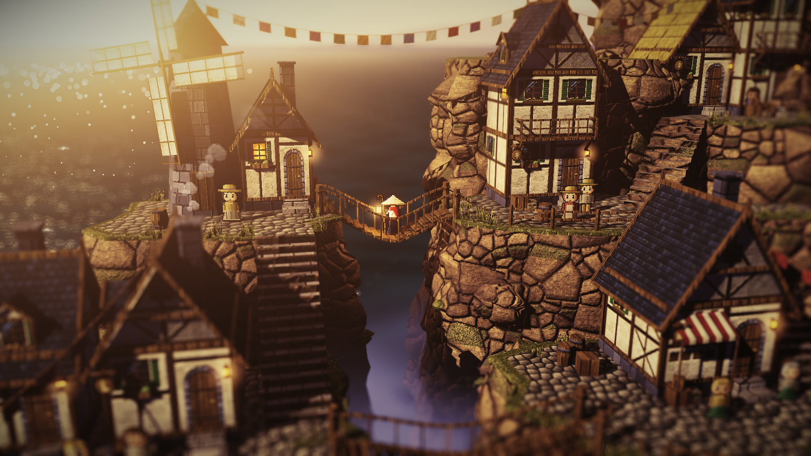

# 픽셀 빌리지 한국어판


코드로 그린 픽셀 아트와 3D 조명이 만나는 해안 절벽 마을 산책 데모입니다. 등불을 든 여행자가 돌계단과 흔들리는 밧줄 다리를 지나 마을을 둘러봅니다.

[바로 실행](https://sigco3111.github.io/pixel-village-ko/) · [저장소](https://github.com/sigco3111/pixel-village-ko)

원작: [Pixel village, @blendi / Patch](https://patch.gg/blendi/pixel-village)

## 주요 특징

- 외부 모델·그림 없이 코드로 생성하는 지형, 건물, 주민, 8방향 여행자 스프라이트
- 노을, 그림자, 빛 번짐, 안개, 피사계 심도와 바다 반짝임
- 걷기·달리기, 계단과 다리 이동, 7초 마을 생성 연출
- 문서 언어·제목·조작 안내·음악 출처 안내 한국어화
- 계정이나 서버 없이 정적으로 실행

## 조작

| 입력 | 동작 |
|---|---|
| WASD 또는 방향키 | 이동 |
| Shift + 이동 | 달리기 |
| M | 전체 소리 켜기 / 끄기 |
| N | 음악 켜기 / 끄기 |

첫 키 입력 또는 클릭 후 음악이 시작됩니다. 원작처럼 키보드가 필요하며 모바일 터치 조작은 제공하지 않습니다.

별도 대사·퀘스트는 없는 산책 데모입니다. 원작의 공개 설정 목록도 비어 있어 추가 설정 패널은 없습니다. 조작 안내는 잠시 걸으면 원작처럼 사라집니다.

## 실행 화면

위 대표 이미지는 한국어판의 실제 로컬 실행 화면입니다.

아래는 원작 제작자가 공개한 마을 구조 참고 이미지입니다. 한국어판 캡처와 구분해 표시합니다.




## 설치와 실행

Node.js 설치 후 저장소 폴더에서:

```sh
node tools/serve.mjs
```

브라우저에서 `http://localhost:5545`를 엽니다. 파일을 더블클릭하는 `file://` 방식은 ES 모듈 때문에 지원하지 않습니다.

```sh
node build.mjs
```

`dist/`에 정적 배포 파일을 만듭니다. 루트의 `index.html`도 바로 정적 호스팅할 수 있습니다. 배포용으로 npm 설치는 필요하지 않습니다.

- `?intro`: 마을 생성 연출
- `?nomusic`: 음악을 끈 상태로 시작
- `?clean`: 화면 안내 숨김

## 기술 메모와 검증

- three.js r186, WebGL 기반. 그래픽 가속을 지원하는 최신 데스크톱 브라우저 권장.
- `textures.js`: 픽셀 텍스처·스프라이트, `world.js`: 지형·집·다리·이동 판정, `main.js`: 조명·카메라·캐릭터·후처리.
- HTML, JS와 데이터 전체에서 화면 표시 문자열을 점검했습니다. 간판은 글자가 아니라 그림 아이콘입니다. 음악 제목과 저작자 이름은 정확한 출처를 위해 원문을 유지했습니다.
- 로컬 Chromium에서 마을 렌더·한국어 표시를 확인하고, 고정 시간 스텝 테스트로 이동 좌표 변화를 확인했습니다. 10개 경사로의 이동 판정 검사도 오류 없이 통과했습니다.
- 소프트웨어 GPU에서는 매우 느립니다. 실기기 프레임 속도, 마을 전체 수동 탐험, 모든 계단의 실제 주행, 모바일은 미검증입니다.
- 원작 전용 Patch 호스트 통신 도우미는 독립 실행판에서 제외했습니다. 마을 렌더링·이동·음악 로직은 유지합니다.

## 사운드와 라이선스

- 코드: MIT, 원본 `LICENSE` 보존.
- 코드가 생성한 그림 및 원작 스크린샷: CC0 1.0, 원본 `LICENCE-NOTES.md` 기준.
- three.js: MIT, `lib/THREE-LICENSE` 보존.
- 음악: **"Evening Fall (Harp)" by Kevin MacLeod (incompetech.com)**. [원곡](https://incompetech.com/music/royalty-free/index.html?isrc=USUAN1100236), [CC BY 4.0](https://creativecommons.org/licenses/by/4.0/). 음악 파일은 변경하지 않았습니다.
- 원작 웹 데모의 바다·바람·발걸음은 Sonniss 녹음으로, 원작 공개 저장소에 없는 제한 에셋입니다. 한국어판에도 포함하지 않으며 해당 파일을 요청하지 않습니다. 음악만 재생됩니다.

원작 설명은 `README.original.md`, 원본 권리 내역은 `LICENCE-NOTES.md`와 `MISSING_ASSETS.md`, 한국어판 출처 정리는 `CREDITS.md`, 번역 범위는 `LOCALIZATION.md`를 참고하세요.
