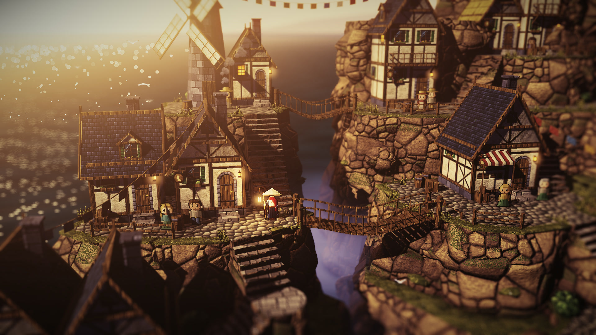

# Pixel village

Pixel art in a real 3D world, for three.js. A village on sea cliffs at sunset in which every surface is a pixel texture drawn by code, 32 pixels to the metre, and lit as a solid thing: relief taken from the drawing itself, long shadows, light that blooms, the sun's rays through the haze, and a lens that is sharp only round the wanderer, who is a flat sprite with walk and run cycles in eight directions. Nothing is loaded to draw it: no models, no pictures, no texture files.



**In the demo:** WASD or the arrow keys walk, Shift runs, M mutes, N turns only the music off. Go up the stairs, over the bridges and along the path to the far terrace.


It is a starting point, not a filter. You can't lay it over a finished game: the look comes from how the textures are drawn and how the picture is finished. Start from this village, change it, replace it.

## The idea

- **Textures are drawn, pixel by pixel, in code.** `textures.js` has a small canvas class, `Pix`, and one function per surface: `crag` (rock), `cobble`, `blocks`, `slate`, `walls` (an atlas of half-timbered panels, windows and doors), `verge`, `signs`, `awning`, and so on. Every one is drawn at 32 pixels to the metre and repeats.
- **Each drawing gives its own relief.** `Pix.normal()` turns a drawing (or a height map drawn beside it) into a normal map, so the low sun rakes across the stones and tiles as if they stood out, while the texture stays crisp pixel art.
- **The world is built from a plan.** `world.js` holds the village as data: `TERRACES` (outlines and heights), `HOUSES`, `STAIRS`, `BRIDGES`, `CAUSEWAYS`. A `Mesher` merges everything by texture, `rockWall` grows a cliff face round any outline, `house` builds a house from a few numbers, `stairs` fits two flights and a landing between two terraces, and `bridge` hangs boards that dip under the walker.
- **Walking follows the plan too.** `makeNav` knows the terraces, stairs and bridges: it finds the highest thing within a step's reach, glides along a stair's nose line, and treats a stair's side as a wall.
- **People are sprites drawn in code.** `hero()` draws the wanderer's sheet (eight walk steps, two idle, eight run, in five views that mirror to eight) from one stride rule; `folk()` draws the townsfolk. They stand upright in the world, take its light and cast shadows.
- **The picture is finished in steps** (`main.js`): the scene with shadows; darkness in the corners from depth; light that blooms off what is bright; the sun's rays; a lens with a real focus on the wanderer, so the near roofs and the far sea go soft; then the grade. The sea's far glints are points the lens opens into discs.
- **It can build itself.** Every piece carries when it should appear. `?intro` plays seven seconds of the village rising out of the sea, piece by piece.

## Use it

There is nothing to build: it is plain modules, with three.js r186 in `lib/`.

```
node tools/serve.mjs     # http://localhost:5545
node build.mjs           # dist/, the demo as it is published
```

- `textures.js` is the pixel art. Start there to change a surface or draw a new one.
- `world.js` is the village. Change the plan at the top of it to move a terrace, add a house or hang another bridge.
- `main.js` is the light, the people, the walking, the sound and the finishing of the picture.
- `?intro` plays the build-up, `?nomusic` starts with the music off, `?clean` hides the hint.

The tools in `tools/` run the demo in a headless Chromium and check it: `shot.mjs` takes stills, `film.mjs` films the build-up frame by frame, `fps.mjs` measures speed, `shimmer.mjs` watches the sea, and `reach.js`, `walkcheck.js`, `climb.js`, `coplanar.js` and `staircheck.js` (run in the page with `shot.mjs`'s `evalfile`) check that everywhere can be walked to and nothing flickers. They need `playwright-core` (`npm install`) and a Chromium of your own (`CHROME`).

## What it costs

About 170,000 triangles and under a millisecond a frame at 1080p on a fast desktop card. It has not been measured on a laptop. The demo is about 8 MB to download: 4.8 MB of it is the music and 2.1 MB three.js.

## Sound

The music is in the repo. The sea, the wind and the footsteps are not: they are recordings that may be played in a game but not passed on as files, so a copy of this repo is silent apart from the music. `MISSING_ASSETS.md` says what they are and how to make your own.

## Licence

Code MIT. Everything drawn is made by that code, and what it draws is yours to use as freely. The music is "Evening Fall (Harp)" by Kevin MacLeod, CC BY 4.0: credit him if you keep it. The published demo's sea, wind and footstep recordings are from the Sonniss GDC Game Audio Bundles and are not under an open licence. three.js is MIT. `LICENCE-NOTES.md` has every part and where it came from.
